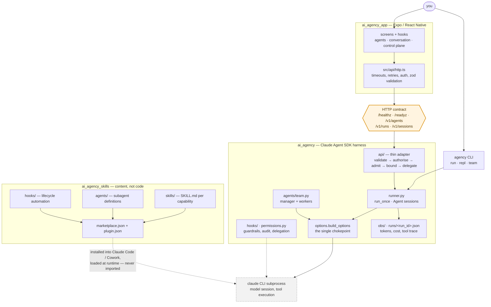

# System overview

How the `ai_agency_*` repos fit together, and — more usefully — where they are *not*
allowed to touch. Read this before the per-repo architecture docs; they assume you know
which box they are inside.

## The shape of it

Three repos, one direction of dependency. The harness knows nothing about the app; the
app knows nothing about the harness's internals; the skills repo is content that either
can load and neither can import.

## The three rules the picture enforces

**1. The HTTP contract is the only thing the app and the harness share.** No shared
package, no generated client checked into both, no import across the boundary. The app
holds its own zod schemas and validates responses at the edge; the harness holds its own
pydantic wire models in `api/schemas.py`, deliberately separate from its internal
`RunRecord` so accounting can change without a wire break. When the two disagree, the
disagreement surfaces as a validation error in one place instead of a wrong render in
twenty. See [ADR 0002](../adr/0002-http-api-is-the-only-cross-repo-seam.md).

**2. Configuration has one chokepoint, and it is inside the harness.** Every path that
runs an agent — CLI, HTTP, evals, tests — builds its `ClaudeAgentOptions` through
`options.build_options(profile)`. Nothing under `api/` constructs options or imports
`runner` directly; routes depend on the `Runner` protocol in `api/deps.py`. The app
therefore cannot configure a run: it picks a `profile` and a `team` by name and the
harness decides what those mean. That is why a UI change can never alter what tools an
agent is allowed to call.

**3. Skills are loaded, not linked.** `ai_agency_skills` ships as a Claude Code plugin
marketplace. Nothing in `ai_agency` imports it and nothing in it imports `ai_agency`;
it reaches a running agent through the Claude Code CLI subprocess that the SDK spawns.
The practical consequence is that a skill change needs no harness release — and that a
broken `SKILL.md` fails in that repo's own validator, not in someone's run.

## What crosses a boundary, and what a change to it costs

| Crossing | Carried by | Breaking it costs |
|---|---|---|
| App → harness | HTTP, `/v1` path prefix | A version prefix bump; `/v2` can sit beside `/v1`, so no flag day |
| Harness → model | `claude` CLI subprocess, spawned by the SDK | Its own environment — credentials do **not** come from the harness's settings object |
| Skills → agent | Plugin install, read at session start | Nothing rebuilds; a bad skill is caught by that repo's validator |
| Harness → disk | `runs/<run_id>.json`, `workspace/` | The only durable state; there is no database |

## Where state lives (and mostly does not)

There is no database anywhere in this system. That is the single fact that explains the
most surprising behaviour:

- **A session is a live subprocess, not a row.** `POST /v1/sessions` holds the Claude
  Code CLI open *between* requests. So sessions are capped, reaped on an idle TTL, and
  serialised — a second message while one is in flight is a `409`, not a queue. Restart
  the harness and every session is gone.
- **The transcript is the client's.** The server keeps no conversation history, so
  `ai_agency_app/src/chat/transcript.ts` is the transcript. Closing the app loses it.
- **Run accounting is a file.** One JSON document per run under `runs/`, with tokens,
  cost, turns and the tool trace.
- **The agent's writable world is `workspace/`.** The guardrail hook blocks writes
  outside it, and the container mounts nothing else writable.

## Reading order

1. This document.
2. [`ai_agency/docs/architecture.md`](https://github.com/shulginilya/ai_agency/blob/main/docs/architecture.md) — four Mermaid views of the harness: run flow, manager/workers, module map, credentials.
3. [`ai_agency_app/docs/control-plane.md`](https://github.com/shulginilya/ai_agency_app/blob/main/docs/control-plane.md) — the client's API layer, endpoint by endpoint.
4. [`ai_agency_skills/CONTRIBUTING.md`](https://github.com/shulginilya/ai_agency_skills/blob/main/CONTRIBUTING.md) — the skill and slash-command format.
5. [Repo map](repo-map.md) — which repo owns which question.
