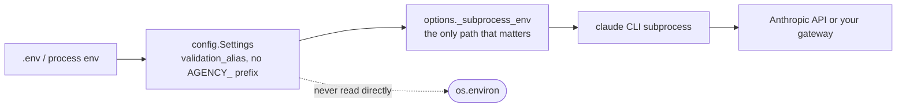

# Environments and credentials

Which secret bills what, where each one has to be set, and the two failure modes that are
silent. This is the cross-repo view; the authoritative per-variable detail is
`ai_agency/.env.example` and `ai_agency_app/.env.example`.

## The thing that surprises everyone

**The harness does not talk to the model.** The Claude Agent SDK spawns the Claude Code
CLI as a subprocess, and *that process* authenticates from **its own environment** — not
from the harness's settings object. Credentials therefore have to be forwarded into the
subprocess environment explicitly; `options._subprocess_env` is what does it. Anything
that bypasses that path leaves the CLI authenticating from a cached `claude login`
instead, and fails much later as "OAuth session expired and could not be refreshed".

## Which credential bills what

Set exactly one, in `ai_agency/.env`.

| Variable | What it bills | Where it comes from |
|---|---|---|
| `ANTHROPIC_AUTH_TOKEN` | Whatever your gateway bills | Your LLM gateway; pair with `ANTHROPIC_BASE_URL` |
| `ANTHROPIC_API_KEY` | Prepaid Console credits | platform.claude.com → Billing |
| `CLAUDE_CODE_OAUTH_TOKEN` | Your Claude subscription | `claude setup-token` (one-year token) |
| *(all blank)* | Your subscription | The `claude login` session in `~/.claude` |

Precedence is fixed and top-down: `config.AUTH_PRECEDENCE` mirrors the CLI's own order
rather than inventing one, so `agency` and a bare `claude` always pick the same credential.

**Two silent failure modes**, both worth recognising on sight:

1. **Shadowing.** Setting two is legal, and the loser is ignored without complaint. A
   stale `ANTHROPIC_API_KEY` sitting next to a fresh `CLAUDE_CODE_OAUTH_TOKEN` keeps
   billing the account you were trying to leave, and surfaces as a credit error naming it.
   `build_options` logs `options.auth_shadowed` and `doctor` warns.
2. **The all-blank row.** It works, it is per-machine, and it expires — after which every
   run fails naming a credential you never chose.

`python tasks.py doctor` prints the active mode, and so does the `api.startup` log line.
Check there before anywhere else.

## Where each variable belongs

| Variable | Set in | Notes |
|---|---|---|
| `ANTHROPIC_*`, `CLAUDE_CODE_OAUTH_TOKEN` | `ai_agency/.env` | The four with no `AGENCY_` prefix; they belong to the subprocess |
| `AGENCY_PROFILE`, `AGENCY_MODEL`, `AGENCY_MAX_TURNS`, `AGENCY_MAX_BUDGET_USD`, `AGENCY_DEFAULT_TEAM` | `ai_agency/.env` | Run posture and limits |
| `AGENCY_API_HOST`, `AGENCY_API_PORT`, `AGENCY_API_KEY`, `AGENCY_API_DOCS_ENABLED` | `ai_agency/.env` | The HTTP surface |
| `AGENCY_API_CORS_ORIGINS`, `…_ORIGIN_REGEX`, `…_ALLOW_CREDENTIALS` | `ai_agency/.env` | Needed only for the app's **web** build |
| `AGENCY_API_MAX_CONCURRENT_RUNS`, `…_RUN_TIMEOUT_S`, `…_MAX_SESSIONS`, `…_SESSION_IDLE_TTL_S`, `…_QUEUE_TIMEOUT_S` | `ai_agency/.env` | Admission control and lifetimes |
| `AGENCY_LOG_LEVEL`, `AGENCY_LOG_FORMAT`, `AGENCY_RUN_DIR` | `ai_agency/.env` | Observability |
| `EXPO_PUBLIC_API_URL` | `ai_agency_app/.env` | Unset = per-platform default; see below |
| `EXPO_PUBLIC_API_TOKEN` | `ai_agency_app/.env` | Must match `AGENCY_API_KEY` if that is set |
| `EXPO_PUBLIC_MOCK_AGENTS` | `ai_agency_app/.env` | Roster fixtures only; conversations still need a server |

In the harness, **no code reads `os.environ` directly** — everything goes through the
typed `Settings` object. The credential variables are the ones without an `AGENCY_`
prefix, read via an explicit `validation_alias` precisely because they are destined for
the subprocess.

## The app's secrets are not secret

`EXPO_PUBLIC_*` values are **inlined into the JS bundle at build time**. Anyone with the
app can read them. Two consequences:

- `EXPO_PUBLIC_API_TOKEN` is a local-development placeholder, never a real credential. For
  anything real, use SecureStore and `setAuthTokenProvider()` in `src/api/client.ts`.
- Editing `.env` while Metro is running changes nothing. Restart the dev server.

## Environments

There is one environment today — a developer machine — plus a container for isolation.
Both are described here so the difference is explicit when a second one appears.

| | Local | Container (`Dockerfile`, `compose.yaml`) |
|---|---|---|
| Profile | `dev` (acceptEdits) | `sandboxed` |
| Writable | `workspace/` by guardrail | `./workspace` only, by mount |
| User | you | non-root |
| API host | `127.0.0.1` | bound in-container |
| Docs at `/docs` | on | off in production |

The container is the real security boundary. The in-process controls —
`setting_sources=[]`, explicit allow/deny tool lists, the `PreToolUse` hook — are the
first layer, not the last.

## Before it leaves your machine

The API executes arbitrary agent prompts. An unauthenticated one is remote code execution
with a REST interface.

- Set `AGENCY_API_KEY`.
- Keep `AGENCY_API_HOST=127.0.0.1` outside containers, and put a reverse proxy in front.
- Set `AGENCY_API_DOCS_ENABLED=false`.
- Leave `AGENCY_API_CORS_ALLOW_CREDENTIALS=false` unless the client authenticates with
  cookies — it is incompatible with `AGENCY_API_CORS_ORIGINS=*`, and the wildcard wins.
- Never commit a `.env`. Both repos ignore it; both ship a `.env.example` that is the
  place to document a new variable.
